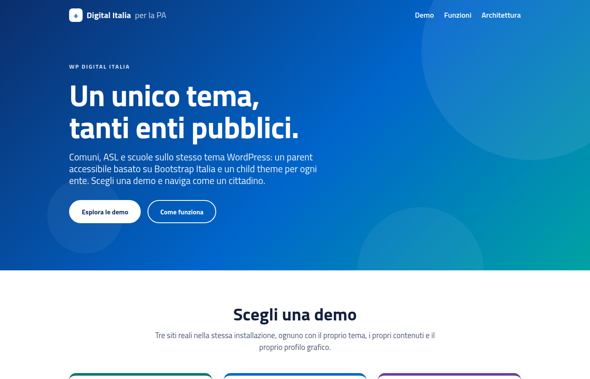
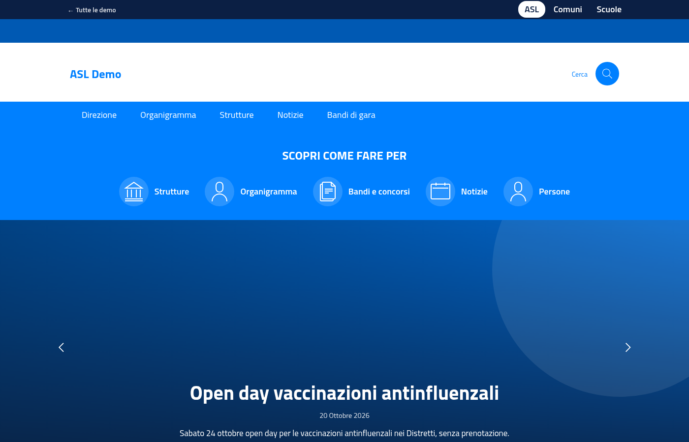
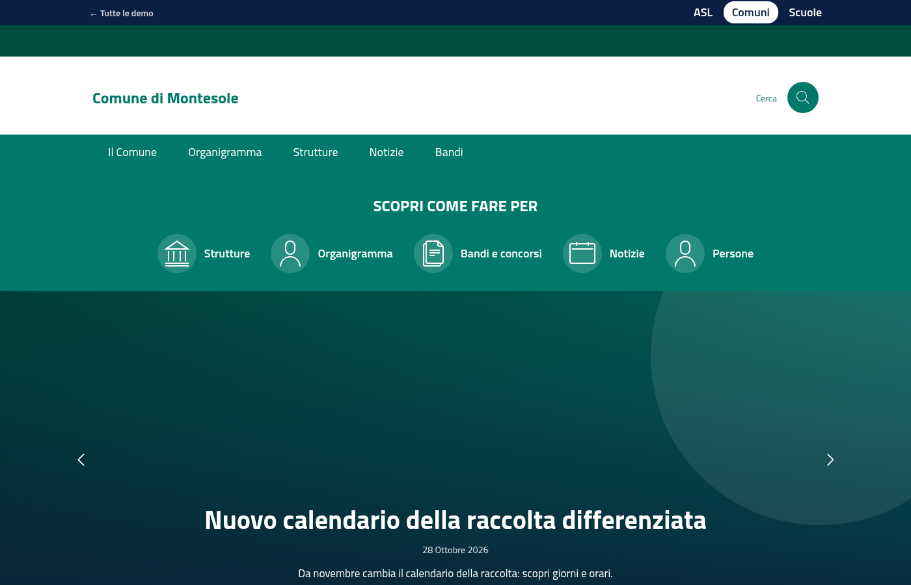
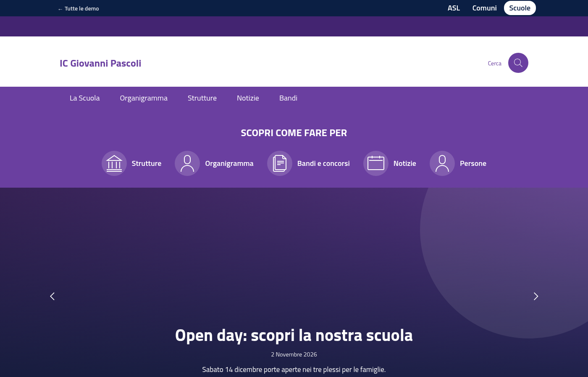
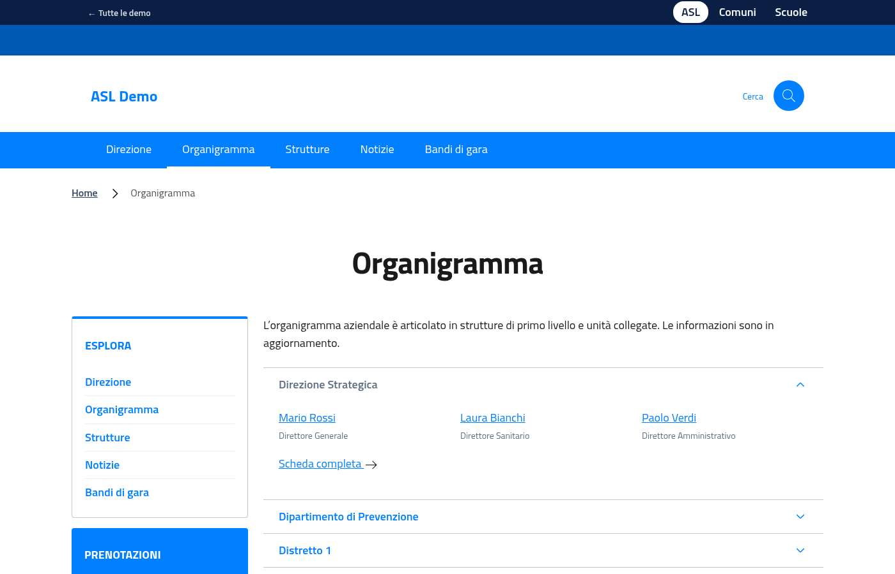

# WP Digital Italia

**Un unico tema WordPress, tanti enti pubblici.** Un parent theme accessibile basato su [Bootstrap Italia](https://italia.github.io/bootstrap-italia/) (font Titillium Web, linee guida AgID) e un child theme per ogni tipo di ente: **Comuni**, **ASL**, **Scuole**.

### 👉 Demo online: **https://wp-pa-demo.programmato.it**

Una rete WordPress multisite con tre siti reali, ognuno con il proprio tema, contenuti e profilo grafico: [Comuni](https://wp-pa-demo.programmato.it/comuni/) · [ASL](https://wp-pa-demo.programmato.it/asl/) · [Scuole](https://wp-pa-demo.programmato.it/scuole/). I dati sono fittizi.



| ASL | Comuni | Scuole |
|---|---|---|
|  |  |  |

## Cosa offre

- **Bootstrap Italia** con asset già compilati nel repository (nessuna build per usarlo).
- **Accessibilità**: landmark, skip link, `aria-*` su tab/accordion/slider, focus visibile, slider con pausa e rispetto di `prefers-reduced-motion`.
- **Layout "portale sanitario"** modellato su portali come aslroma1.it: fascia "Scopri come fare per", hero con slider delle news, tab *Informa*, strutture, guida ai servizi.
- **Boxed o full width** dal Personalizza (default boxed: sfondi a tutta larghezza, contenuti centrati).
- **Sidebar a sinistra a box colorati**: navigazione di sezione contestuale, contatti, accessi rapidi, accordion di servizi e strutture.
- **Organigramma e strutture**: dipartimenti gerarchici con persone, ruoli e unità collegate.
- **Bandi e concorsi**: filtro per anno, stato *In corso*/*Scaduto*, allegati, termini, aggiudicatari.
- **Prenotazione appuntamenti** con slot e calendario; **cookie consent** GDPR granulare.
- **Profili per ente via child theme**: cambiano solo colori e contenuti, il lavoro pesante sta nel parent.



## Struttura del repository

Il repository va clonato direttamente in `wp-content/themes/`:

| Cartella | Tema |
|---|---|
| [`wp-pa-theme/`](wp-pa-theme/README.md) | **Parent**: Bootstrap Italia, layout, CPT, opzioni tema |
| [`wp-pa-theme-asl/`](wp-pa-theme-asl/README.md) | Child per le **ASL** |
| `wp-pa-theme-comune/` | Child per i **Comuni** (profilo verde) |
| `wp-pa-theme-scuola/` | Child per le **Scuole** (profilo viola) |
| `wp-pa-theme-hub/` | Child della **landing di presentazione** della demo multisite |

```
wp-pa-theme  ←  wp-pa-theme-asl      (/asl/)
             ←  wp-pa-theme-comune   (/comuni/)
             ←  wp-pa-theme-scuola   (/scuole/)
             ←  wp-pa-theme-hub      (/ hub)
```

## Installazione rapida

```bash
cd wp-content/themes
git clone git@github.com:ttensrl/wp-pa-theme.git .
```

Da Aspetto → Temi attivare il child desiderato (il parent deve restare installato). Per modificare stili e script del parent: `cd wp-pa-theme && npm install && npm run build`, poi committare anche `dist/`. Opzioni, template e CPT sono documentati nel [README del parent](wp-pa-theme/README.md).

## Demo e deploy

La demo è una installazione multisite con percorsi virtuali (`/comuni/`, `/asl/`, `/scuole/`). I contenuti demo e gli script di deploy (WP-CLI, `rsync`, push del DB) stanno nella cartella dell'installazione WordPress, fuori da questo repository.

## Licenza e contatti

GPL v2 o successiva. Realizzato da TTEN. Assistenza: luca.terribili@tten.it
